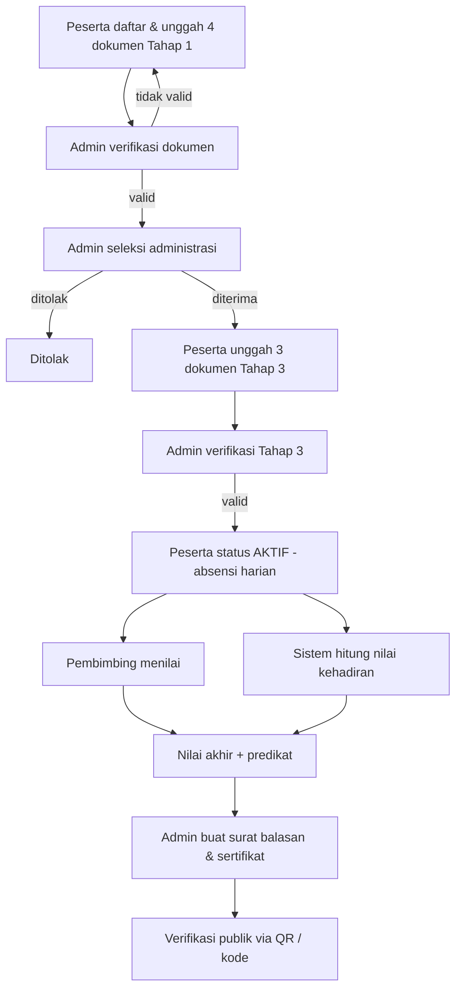

# ERD - Sistem Pendaftaran & Manajemen Magang (Prakerin)

PT United Tractors Samarinda

Dokumen ini menjelaskan model data (Entity Relationship Diagram) aplikasi. Diagram
menggunakan sintaks [Mermaid](https://mermaid.js.org/syntax/entityRelationshipDiagram.html)
sehingga dapat ditampilkan langsung di GitHub, GitLab, atau editor yang mendukung Mermaid.

> Singkatan relasi: `||--o{` = satu-ke-banyak (opsional), `||--o|` = satu-ke-satu
> (opsional), `}o--||` = banyak-ke-satu.

## Diagram

```mermaid
erDiagram
    users ||--o| pembimbing : "akun pembimbing"
    users ||--o| peserta : "akun peserta"

    pembimbing ||--o{ peserta : "membimbing"
    pembimbing ||--o{ penilaian_pembimbing : "menilai"

    peserta ||--o{ dokumen : "mengunggah"
    peserta ||--o| seleksi_administrasi : "diseleksi"
    peserta ||--o{ absensi : "absen"
    peserta ||--o| nilai_kehadiran : "nilai kehadiran"
    peserta ||--o| penilaian_pembimbing : "dinilai"
    peserta ||--o| nilai_akhir : "nilai akhir"
    peserta ||--o| surat_balasan : "surat balasan"
    peserta ||--o| sertifikat : "sertifikat"
    peserta ||--o{ riwayat_status : "riwayat"

    users ||--o{ dokumen : "verifikasi"
    users ||--o{ seleksi_administrasi : "seleksi"
    users ||--o{ absensi : "setujui izin"
    users ||--o{ surat_balasan : "buat surat"
    users ||--o{ sertifikat : "buat sertifikat"
    users ||--o{ riwayat_status : "ubah status"

    users {
        bigint id PK
        string name
        string email UK
        string role "admin | pembimbing | user"
        timestamp email_verified_at
        string password
        string remember_token
        timestamp created_at
        timestamp updated_at
    }

    pembimbing {
        bigint id PK
        bigint user_id FK "users.id, unik"
        string nip
        string divisi
        string jabatan
        timestamp created_at
        timestamp updated_at
    }

    peserta {
        bigint id PK
        bigint user_id FK "users.id"
        string nama_lengkap
        string nik
        string instansi_pendidikan
        string jurusan
        enum jenjang "SMK | D3 | S1 | lainnya"
        string no_hp
        text alamat
        date tanggal_mulai
        date tanggal_selesai
        string divisi_diajukan
        bigint pembimbing_id FK "pembimbing.id, null"
        string divisi_penempatan
        enum status_tahap "pendaftaran | seleksi_administrasi | pemenuhan_dokumen | aktif | selesai | ditolak"
        timestamp created_at
        timestamp updated_at
    }

    dokumen {
        bigint id PK
        bigint peserta_id FK "peserta.id"
        enum jenis "surat_pengantar | cv | kartu_identitas | transkrip_nilai | bpjs_kesehatan | asuransi_kecelakaan | surat_sehat"
        tinyint tahap "1 atau 3"
        string path_file
        string nama_asli
        enum status_verifikasi "menunggu | valid | tidak_valid"
        text catatan
        bigint diverifikasi_oleh FK "users.id, null"
        timestamp diverifikasi_pada
        timestamp created_at
        timestamp updated_at
    }

    seleksi_administrasi {
        bigint id PK
        bigint peserta_id FK "peserta.id, unik"
        boolean berkas_lengkap
        boolean kompetensi_sesuai
        boolean periode_sesuai
        enum keputusan "diterima | ditolak | revisi"
        text catatan
        bigint dinilai_oleh FK "users.id"
        timestamp created_at
        timestamp updated_at
    }

    absensi {
        bigint id PK
        bigint peserta_id FK "peserta.id"
        date tanggal "unik per peserta"
        time jam_masuk
        enum status "hadir | izin | sakit | alpa"
        text keterangan
        string lampiran
        boolean disetujui "null=menunggu"
        bigint disetujui_oleh FK "users.id, null"
        timestamp created_at
        timestamp updated_at
    }

    hari_libur {
        bigint id PK
        date tanggal UK
        string keterangan
        timestamp created_at
        timestamp updated_at
    }

    nilai_kehadiran {
        bigint id PK
        bigint peserta_id FK "peserta.id, unik"
        int total_hari_kerja
        int jumlah_hadir
        int jumlah_izin
        int jumlah_sakit
        int jumlah_alpa
        double nilai "basis 100"
        timestamp dihitung_pada
        timestamp created_at
        timestamp updated_at
    }

    penilaian_pembimbing {
        bigint id PK
        bigint peserta_id FK "peserta.id, unik"
        bigint pembimbing_id FK "pembimbing.id"
        tinyint disiplin "0-100"
        tinyint kerja_sama "0-100"
        tinyint inisiatif "0-100"
        tinyint kualitas_kerja "0-100"
        tinyint komunikasi "0-100"
        double rata_rata
        text catatan
        string file_penilaian
        timestamp created_at
        timestamp updated_at
    }

    nilai_akhir {
        bigint id PK
        bigint peserta_id FK "peserta.id, unik"
        double nilai_pembimbing
        double nilai_kehadiran
        double nilai_akhir
        string predikat "Sangat Baik | Baik | Cukup | Kurang"
        timestamp created_at
        timestamp updated_at
    }

    surat_balasan {
        bigint id PK
        bigint peserta_id FK "peserta.id"
        string nomor_surat UK
        date tanggal_surat
        string path_file
        bigint dibuat_oleh FK "users.id"
        timestamp created_at
        timestamp updated_at
    }

    sertifikat {
        bigint id PK
        bigint peserta_id FK "peserta.id"
        string nomor_sertifikat UK
        string kode_verifikasi UK "QR publik"
        date tanggal_terbit
        string path_file
        bigint dibuat_oleh FK "users.id"
        timestamp created_at
        timestamp updated_at
    }

    pengaturan {
        bigint id PK
        string kunci UK
        text nilai
        string keterangan
        timestamp created_at
        timestamp updated_at
    }

    riwayat_status {
        bigint id PK
        bigint peserta_id FK "peserta.id"
        string status_lama "null saat awal"
        string status_baru
        bigint oleh FK "users.id, null"
        text catatan
        timestamp created_at
        timestamp updated_at
    }
```



## Catatan model

### Alur status peserta (`peserta.status_tahap`)

```
pendaftaran -> seleksi_administrasi -> pemenuhan_dokumen -> aktif -> selesai
                                            \-> ditolak
```

Setiap perubahan dicatat pada tabel `riwayat_status` melalui `StatusService`.

### Relasi kunci

- **users → pembimbing / peserta** bersifat satu-ke-satu (kolom `user_id` unik).
  Satu akun `users` hanya boleh menjadi satu pembimbing atau satu peserta.
- **peserta → pembimbing** banyak-ke-satu; pembimbing dapat membimbing banyak peserta.
  Penugasan pembimbing menentukan siapa yang dapat menilai peserta.
- **peserta → dokumen** satu-ke-banyak, dengan batas unik `(peserta_id, jenis)`.
  Terdapat 4 dokumen Tahap 1 (`tahap = 1`) dan 3 dokumen Tahap 3 (`tahap = 3`).
- **peserta → nilai_kehadiran / penilaian_pembimbing / nilai_akhir / surat_balasan /
  sertifikat** masing-masing satu-ke-satu (unik per `peserta_id`).
- **absensi** unik pada `(peserta_id, tanggal)`; kolom `disetujui` bernilai
  `NULL` (menunggu) / `1` (setuju) / `0` (tolak) untuk pengajuan izin & sakit.
- **hari_libur** dan **pengaturan** bersifat berdiri sendiri (master data).

### Nilai akhir

`nilai_akhir.nilai_akhir` dihitung dari gabungan berbobot (default 60% penilaian
pembimbing + 40% nilai kehadiran) yang disimpan pada tabel `pengaturan`, kemudian
dipetakan ke `predikat`.

## Diagram alur proses


